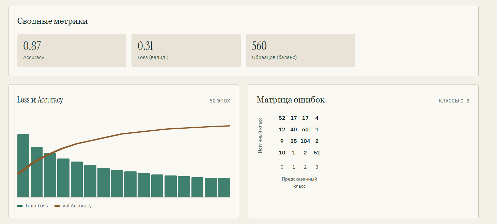

# Отчёт за 02.11–08.11

1. **Доработка отображения промежуточных результатов**
   - Исправлено отображение промежуточных результатов анализа.
   - Проверена корректность вывода получаемых данных в интерфейсе приложения.
   - Устранены выявленные недочёты, затруднявшие просмотр результатов обработки.

2. **Тестирование системы на реальных данных**
   - Проведена проверка работы приложения на реальных геномных данных.
   - Проверена корректность загрузки и обработки входных CSV-файлов.
   - Выполнено тестирование работы модели классификации Ascochyta.
   - Проанализированы получаемые результаты прогнозирования для оценки стабильности работы системы.

